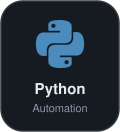

<a href="https://nitaru.github.io">
  <picture>
    <source media="(prefers-color-scheme: dark)" srcset="./assets/header/header-dark.svg">
    <source media="(prefers-color-scheme: light)" srcset="./assets/header/header-light.svg">
    
  </picture>
</a>

  ↑ The pulse never stops. Neither should the service.

  <!-- Keep tags adjacent so link whitespace does not appear underlined. -->
  <a href="https://nitaru.github.io"><picture><source media="(prefers-color-scheme: dark)"
    srcset="./assets/social/website-dark.svg"><source media="(prefers-color-scheme: light)"
    srcset="./assets/social/website-light.svg"></picture></a>
  <a href="https://www.linkedin.com/in/nika-tolordava-2b82a6231"><picture><source media="(prefers-color-scheme: dark)"
    srcset="./assets/social/linkedin-dark.svg"><source media="(prefers-color-scheme: light)"
    srcset="./assets/social/linkedin-light.svg"></picture></a>
  <a href="mailto:nikoloztolordava10@gmail.com"><picture><source media="(prefers-color-scheme: dark)"
    srcset="./assets/social/email-dark.svg"><source media="(prefers-color-scheme: light)"
    srcset="./assets/social/email-light.svg"></picture></a>
  <a href="https://github.com/Nitaru?tab=repositories"><picture><source media="(prefers-color-scheme: dark)"
    srcset="./assets/social/github-dark.svg"><source media="(prefers-color-scheme: light)"
    srcset="./assets/social/github-light.svg"></picture></a>

 

  

## Hi, I'm Nika 👋

Support engineer (L2) at **Virtuozzo** in Tbilisi, and a Computer Science student at Ilia State University (graduating 2027).
Since March 2026 I investigate incidents on production cloud and storage clusters built on Linux, KVM and OpenStack, and I'm building my path toward **Linux administration, infrastructure operations and SRE/DevOps-style work**.

---

## What I do day to day

- Investigate problems on production clusters over SSH: logs, services, kernel messages, hardware health and networking
- Find root causes from evidence, explain them clearly to customers, and escalate to developers with a timeline and a clear split between what is verified and what is not
- Work with KVM/libvirt VMs, OpenStack services (compute, networking, volumes), a distributed storage cluster and the platform's alerting
- Write documentation and notes on recurring issues, and track work in ticketing systems and issue trackers

---

## Skills

Practical, from about 9 months of production support.

  
<strong>Linux &amp; troubleshooting</strong>

   

- journalctl, dmesg, systemd, packages and updates, time sync
- Memory and NUMA pressure, OOM-killer reports, swap behavior
- Disk and NVMe health (SMART, kernel I/O errors), BMC/IPMI event logs

  
<strong>Virtualization &amp; cloud</strong>

   

- KVM/QEMU/libvirt, live migration, HA and node maintenance
- OpenStack: Nova, Neutron with Open vSwitch, Cinder
- Platform CLI and REST-based tooling

  
<strong>Storage &amp; networking</strong>

   

- Distributed storage basics: disks, chunk services, cluster health
- VLANs, bonds, MTU, DHCP/DNS basics, Open vSwitch ports and bridges
- Still strengthening networking (CCNA track)

  
<strong>Automation &amp; infrastructure as code</strong>

   

- Bash: loops that run the same read-only checks on many nodes, log filtering with grep, awk and sed
- Terraform: modules, remote state and a policy-checked stack on AWS (see projects)
- Ansible: a two-VM hardened environment configured entirely by roles (see projects), Git

  
<strong>Monitoring &amp; scripting</strong>

   

- Daily work with platform alerts and telemetry
- Prometheus, Grafana and Loki: built full monitoring stacks with custom exporters and alerting (see projects)
- Python basics, JavaScript/Node basics, Docker basics

---

## Featured labs & projects

> **Each one runs, is tested, and says what it does not cover.**

<a href="https://github.com/Nitaru/AWS-Terraform-Hands-On"><picture><source media="(prefers-color-scheme: dark)" srcset="./assets/projects/terraform-dark.svg"><source media="(prefers-color-scheme: light)" srcset="./assets/projects/terraform-light.svg"></picture></a>
A VPC with public and private subnets, a bastion limited to one admin address and an Auto Scaling web tier behind an Application Load Balancer, written as Terraform modules with remote state in S3. Applied to a real account (37 resources), verified from outside (9 checks), tested by killing an instance (capacity back in 102 s, 5.2% of requests failed meanwhile), then destroyed. Checkov and tflint run in CI.
 

---

<a href="https://github.com/Nitaru/Kubernetes-Hands-On"><picture><source media="(prefers-color-scheme: dark)" srcset="./assets/projects/kubernetes-dark.svg"><source media="(prefers-color-scheme: light)" srcset="./assets/projects/kubernetes-light.svg"></picture></a>
A production-style platform on a 3-node kind cluster, built with Helm: Traefik ingress, HPA autoscaling, zero-downtime rollouts, a PodDisruptionBudget, hardened pods, a Redis StatefulSet and default-deny NetworkPolicies enforced by Calico. Built from scratch by one script, with demos for rollouts, self-healing, autoscaling, network isolation and node drain, plus smoke tests and CI.
 

---

<a href="https://github.com/Nitaru/Linux-Hands-On"><picture><source media="(prefers-color-scheme: dark)" srcset="./assets/projects/linux-dark.svg"><source media="(prefers-color-scheme: light)" srcset="./assets/projects/linux-light.svg"></picture></a>
A hardened two-VM Linux environment configured entirely with Ansible. Key-only SSH, UFW, fail2ban, a bastion host with ProxyJump, a WireGuard VPN with NAT, and a SHA-256 file integrity checker on a systemd timer. Comes with a 42-point verification script and scripted attack demos (SSH brute force, log tampering).
 

---

<a href="https://github.com/Nitaru/Nitaru_DevOps_Shenanigans"><picture><source media="(prefers-color-scheme: dark)" srcset="./assets/projects/devops-dark.svg"><source media="(prefers-color-scheme: light)" srcset="./assets/projects/devops-light.svg"></picture></a>
Four projects that each run locally with Docker Compose: Consul service discovery, a 5-service Docker app, zero-downtime blue-green deployments with CI/CD, and a Prometheus + Grafana + Loki monitoring stack with custom exporters and alerting.
 

---

<a href="https://nitaru.github.io"><picture><source media="(prefers-color-scheme: dark)" srcset="./assets/projects/portfolio-dark.svg"><source media="(prefers-color-scheme: light)" srcset="./assets/projects/portfolio-light.svg"></picture></a>
My portfolio site, with the same projects and write-ups.
 

---

## Studying

<!-- Keep tags adjacent so link whitespace does not appear underlined. -->
<a href="https://aws.amazon.com/certification/certified-solutions-architect-associate/"><picture><source media="(prefers-color-scheme: dark)"
  srcset="./assets/study/aws-dark.svg"><source media="(prefers-color-scheme: light)"
  srcset="./assets/study/aws-light.svg"></picture></a>
<a href="https://www.redhat.com/en/services/training/ex200-red-hat-certified-system-administrator-rhcsa-exam"><picture><source media="(prefers-color-scheme: dark)"
  srcset="./assets/study/redhat-dark.svg"><source media="(prefers-color-scheme: light)"
  srcset="./assets/study/redhat-light.svg"></picture></a>
<a href="https://www.cisco.com/site/us/en/learn/training-certifications/certifications/enterprise/ccna/index.html"><picture><source media="(prefers-color-scheme: dark)"
  srcset="./assets/study/cisco-dark.svg"><source media="(prefers-color-scheme: light)"
  srcset="./assets/study/cisco-light.svg"></picture></a>
<a href="https://www.python.org"><picture><source media="(prefers-color-scheme: dark)"
  srcset="./assets/study/python-dark.svg"><source media="(prefers-color-scheme: light)"
  srcset="./assets/study/python-light.svg"></picture></a>

---

## How I work

- Evidence first, and read-only checks before any change
- Separate verified facts from guesses
- Write it down, so the next person doesn't have to rediscover it
- Use AI assistants to speed up analysis, and always verify against the documentation and a lab

---

## Looking for

Linux administration, infrastructure operations and SRE/DevOps-oriented roles, where I can keep growing by doing.

---

## Contact

  <a href="https://nitaru.github.io">nitaru.github.io</a> ·
  <a href="mailto:nikoloztolordava10@gmail.com">nikoloztolordava10@gmail.com</a> ·
  <a href="https://www.linkedin.com/in/nika-tolordava-2b82a6231">LinkedIn</a>

