<a href="https://nitaru.github.io">
  <picture>
    <source media="(prefers-color-scheme: dark)" srcset="./assets/header/header-dark.svg">
    <source media="(prefers-color-scheme: light)" srcset="./assets/header/header-light.svg">
    
  </picture>
</a>

  ↑ The pulse never stops. Neither should the service.

  <!-- Keep tags adjacent so link whitespace does not appear underlined. -->
  <a href="https://nitaru.github.io"><picture><source media="(prefers-color-scheme: dark)"
    srcset="./assets/cards/link-website-dark.svg"><source media="(prefers-color-scheme: light)"
    srcset="./assets/cards/link-website-light.svg"></picture></a>
  <a href="https://www.linkedin.com/in/nika-tolordava-2b82a6231"><picture><source media="(prefers-color-scheme: dark)"
    srcset="./assets/cards/link-linkedin-dark.svg"><source media="(prefers-color-scheme: light)"
    srcset="./assets/cards/link-linkedin-light.svg"></picture></a>
  <a href="mailto:nikoloztolordava10@gmail.com"><picture><source media="(prefers-color-scheme: dark)"
    srcset="./assets/cards/link-email-dark.svg"><source media="(prefers-color-scheme: light)"
    srcset="./assets/cards/link-email-light.svg"></picture></a>
  <a href="https://github.com/Nitaru?tab=repositories"><picture><source media="(prefers-color-scheme: dark)"
    srcset="./assets/cards/link-github-dark.svg"><source media="(prefers-color-scheme: light)"
    srcset="./assets/cards/link-github-light.svg"></picture></a>
  <a href="./cv/Nikoloz_Tolordava_CV.pdf"><picture><source media="(prefers-color-scheme: dark)"
    srcset="./assets/cards/link-cv-dark.svg"><source media="(prefers-color-scheme: light)"
    srcset="./assets/cards/link-cv-light.svg"></picture></a>

 

  

<h3 align="center"><picture><source media="(prefers-color-scheme: dark)" srcset="./assets/cards/heading-intro-dark.svg"><source media="(prefers-color-scheme: light)" srcset="./assets/cards/heading-intro-light.svg"></picture></h3>

Support engineer (L2) at <strong>Virtuozzo</strong> in Tbilisi and Computer Science student at Ilia State University (graduating 2027).
Since March 2026 I investigate incidents on production cloud and storage clusters built on Linux, KVM and OpenStack,
and I'm building my path toward <strong>Linux administration, infrastructure operations and SRE/DevOps-style work</strong>.

<h3 align="center"><picture><source media="(prefers-color-scheme: dark)" srcset="./assets/cards/heading-daily-dark.svg"><source media="(prefers-color-scheme: light)" srcset="./assets/cards/heading-daily-light.svg"></picture></h3>

<picture><source media="(prefers-color-scheme: dark)" srcset="./assets/cards/daily-dark.svg"><source media="(prefers-color-scheme: light)" srcset="./assets/cards/daily-light.svg">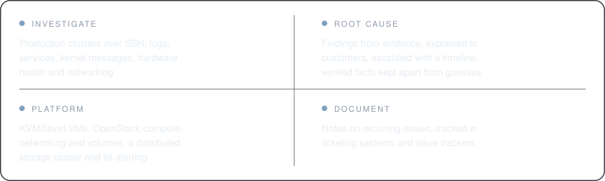</picture>

<h3 align="center"><picture><source media="(prefers-color-scheme: dark)" srcset="./assets/cards/heading-skills-dark.svg"><source media="(prefers-color-scheme: light)" srcset="./assets/cards/heading-skills-light.svg"></picture></h3>

<picture><source media="(prefers-color-scheme: dark)" srcset="./assets/cards/skills-dark.svg"><source media="(prefers-color-scheme: light)" srcset="./assets/cards/skills-light.svg">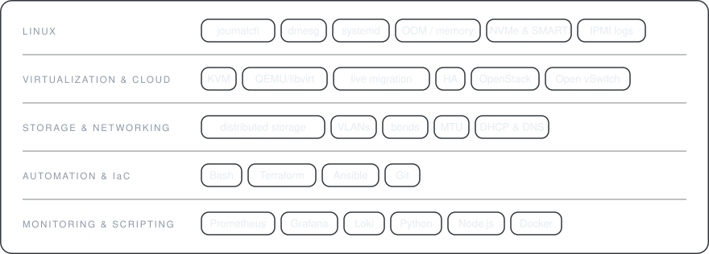</picture>

  From about 9 months of production support. Python, Node.js and Docker at a basic level.

<h3 align="center"><picture><source media="(prefers-color-scheme: dark)" srcset="./assets/cards/heading-projects-dark.svg"><source media="(prefers-color-scheme: light)" srcset="./assets/cards/heading-projects-light.svg"></picture></h3>

  <em>Each one runs, is tested, and says what it does not cover.</em>

<a href="https://github.com/Nitaru/AWS-Terraform-Hands-On"><picture><source media="(prefers-color-scheme: dark)" srcset="./assets/cards/project-terraform-dark.svg"><source media="(prefers-color-scheme: light)" srcset="./assets/cards/project-terraform-light.svg">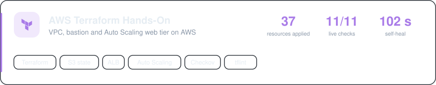</picture></a>

<a href="https://github.com/Nitaru/Kubernetes-Hands-On"><picture><source media="(prefers-color-scheme: dark)" srcset="./assets/cards/project-kubernetes-dark.svg"><source media="(prefers-color-scheme: light)" srcset="./assets/cards/project-kubernetes-light.svg">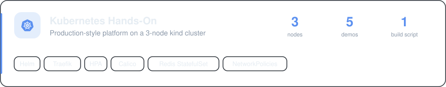</picture></a>

<a href="https://github.com/Nitaru/Linux-Hands-On"><picture><source media="(prefers-color-scheme: dark)" srcset="./assets/cards/project-linux-dark.svg"><source media="(prefers-color-scheme: light)" srcset="./assets/cards/project-linux-light.svg">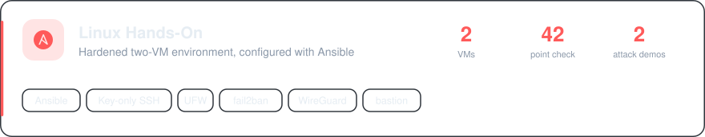</picture></a>

<a href="https://github.com/Nitaru/Nitaru_DevOps_Shenanigans"><picture><source media="(prefers-color-scheme: dark)" srcset="./assets/cards/project-devops-dark.svg"><source media="(prefers-color-scheme: light)" srcset="./assets/cards/project-devops-light.svg">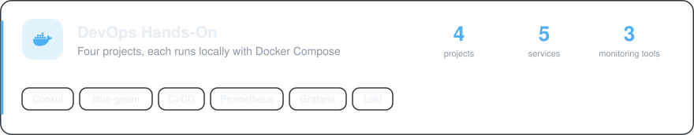</picture></a>

<a href="https://nitaru.github.io"><picture><source media="(prefers-color-scheme: dark)" srcset="./assets/cards/project-portfolio-dark.svg"><source media="(prefers-color-scheme: light)" srcset="./assets/cards/project-portfolio-light.svg"></picture></a>

<h3 align="center"><picture><source media="(prefers-color-scheme: dark)" srcset="./assets/cards/heading-numbers-dark.svg"><source media="(prefers-color-scheme: light)" srcset="./assets/cards/heading-numbers-light.svg"></picture></h3>

<picture><source media="(prefers-color-scheme: dark)" srcset="./assets/cards/languages-dark.svg"><source media="(prefers-color-scheme: light)" srcset="./assets/cards/languages-light.svg">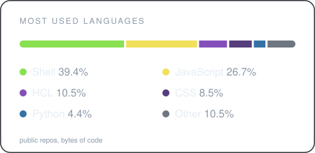</picture>
<picture><source media="(prefers-color-scheme: dark)" srcset="./assets/cards/lab-dark.svg"><source media="(prefers-color-scheme: light)" srcset="./assets/cards/lab-light.svg">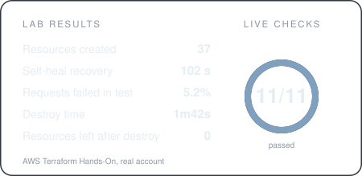</picture>

  Languages: bytes of code in my public repos, as GitHub detects them. Lab results: measured in <a href="https://github.com/Nitaru/AWS-Terraform-Hands-On">AWS Terraform Hands-On</a> on a real account, then destroyed.

<h3 align="center"><picture><source media="(prefers-color-scheme: dark)" srcset="./assets/cards/heading-studying-dark.svg"><source media="(prefers-color-scheme: light)" srcset="./assets/cards/heading-studying-light.svg"></picture></h3>

<!-- Keep tags adjacent so link whitespace does not appear underlined. -->
<a href="https://aws.amazon.com/certification/certified-solutions-architect-associate/"><picture><source media="(prefers-color-scheme: dark)"
  srcset="./assets/study/aws-dark.svg"><source media="(prefers-color-scheme: light)"
  srcset="./assets/study/aws-light.svg"></picture></a>
<a href="https://www.redhat.com/en/services/training/ex200-red-hat-certified-system-administrator-rhcsa-exam"><picture><source media="(prefers-color-scheme: dark)"
  srcset="./assets/study/redhat-dark.svg"><source media="(prefers-color-scheme: light)"
  srcset="./assets/study/redhat-light.svg">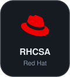</picture></a>
<a href="https://www.cisco.com/site/us/en/learn/training-certifications/certifications/enterprise/ccna/index.html"><picture><source media="(prefers-color-scheme: dark)"
  srcset="./assets/study/cisco-dark.svg"><source media="(prefers-color-scheme: light)"
  srcset="./assets/study/cisco-light.svg">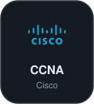</picture></a>
<a href="https://www.python.org"><picture><source media="(prefers-color-scheme: dark)"
  srcset="./assets/study/python-dark.svg"><source media="(prefers-color-scheme: light)"
  srcset="./assets/study/python-light.svg"></picture></a>

<h3 align="center"><picture><source media="(prefers-color-scheme: dark)" srcset="./assets/cards/heading-looking-dark.svg"><source media="(prefers-color-scheme: light)" srcset="./assets/cards/heading-looking-light.svg"></picture></h3>

<picture><source media="(prefers-color-scheme: dark)" srcset="./assets/cards/looking-dark.svg"><source media="(prefers-color-scheme: light)" srcset="./assets/cards/looking-light.svg">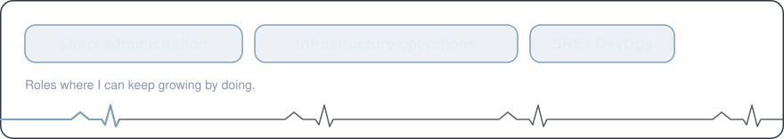</picture>

